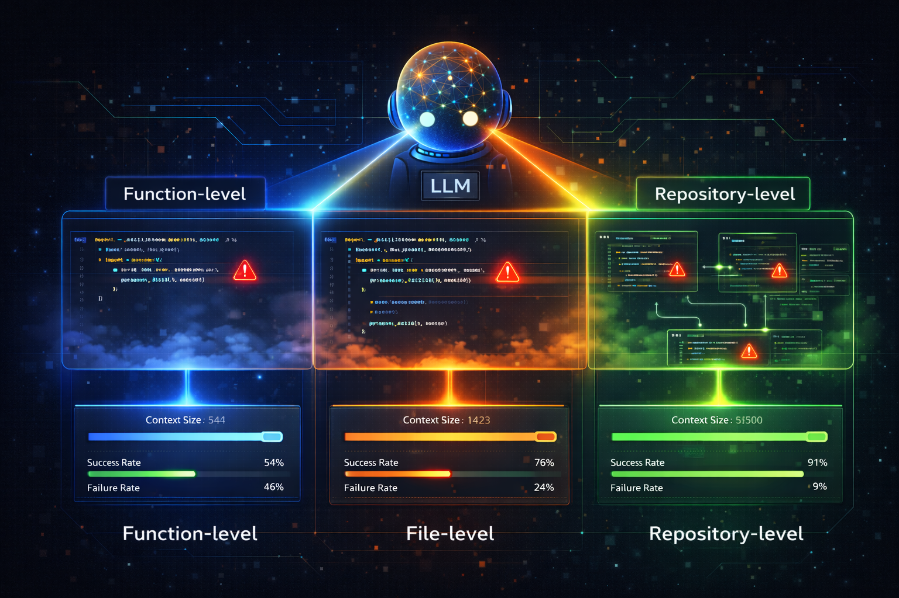

# How Much Context Is Enough? A Comparative Study of Input Scope of Code and Prompting in LLM-Based Vulnerability Detection

<div align="center">
  
</div>

## Installation

Requires **Python ≥ 3.12** (developed on Ubuntu 22.04).

```bash
python -m venv env
source env/bin/activate
pip install -r requirements.txt
```

## Setup

The datasets and saved runs are shipped as compressed archives in the repository; extract them in place:

```bash
tar xzf data.tar.gz        # -> data/     (evaluation, training, and RAG-demonstration JSONL)
tar xzf results.tar.gz     # -> results/  (saved runs for every model, used by expr.ipynb)
```

The SFT LoRA adapters (~1 GB of safetensors) do not compress and are hosted on Google Drive. Download them only if you want to serve the fine-tuned (SFT) models:

```bash
pip install gdown
gdown 1WAfmGDkf6wQ5X6hvAEhhr012gnhqyBm_ -O models.tar.gz
tar xzf models.tar.gz      # -> models/
```

---

## Reproducing the paper

```bash
# all paper tables, the RQ3 figures, and in-text numbers from the saved runs
python -m src.analysis.paper_tables          # -> paper/tables, paper/figures, paper/paper_numbers.json
python -m src.analysis.sft_truncation        # SFT input-length table (needs the base tokenizers)
```

`expr.ipynb` contains the same metric code cell by cell.

### SFT adapters

One LoRA adapter per base checkpoint (rank 16, alpha 32, dropout 0.05, one epoch, lr 2e-4, effective batch 16, max length 4,096); the two Nemotron modes share one adapter:

```bash
python -m src.core.sft -m Qwen/Qwen3-30B-A3B-Instruct-2507 -d data/FuncFileRepo.train.jsonl -o models/Qwen3_30B_A3B_Instruct_2507
python -m src.core.sft -m nvidia/NVIDIA-Nemotron-Nano-12B-v2 -d data/FuncFileRepo.train.jsonl -o models/NVIDIA_Nemotron_Nano_12B_v2 \
    --control-token /no_think --trust-remote-code
```

Serve a base model with its adapter (`vllm serve <repo> --enable-lora --lora-modules <model>-sft=<adapter dir> --max-lora-rank 32 --max-model-len 131072`) and evaluate with `run.py -p sft -m <model>-sft`.

---

## Running the experiment

Every run evaluates one served model on all three scopes for the given strategies, resuming automatically (rows already scored are skipped; use `-r` to recompute).

```bash
# Local open-weight model (serve it with vLLM first, then point LOCAL_API_URL at it)
python run.py -d data/FuncFileRepo.test.jsonl -m qwen3-30b-instruct -s results -l 32 -e 3 -p zero,rag

# Reasoning model (emits a thinking trace before the verdict)
python run.py -d data/FuncFileRepo.test.jsonl -m qwen3-30b-thinking --reasoning -l 24 -e 3 -p zero,rag
```

### Options

| Short | Long              | Default                          | Description |
| ----- | ----------------- | -------------------------------- | ----------- |
| `-d`  | `--dataset`       | `data/FuncFileRepo.test.jsonl`   | Dataset JSONL (one sample per line). |
| `-s`  | `--savedir`       | `results`                        | Root directory for saved runs. |
| `-m`  | `--model`         | `llama3.1:8b`                    | Model id (selects the backend by prefix). |
| `-t`  | `--temperature`   | `None`                           | If unset, the served model's own default applies. |
| `-l`  | `--limit`         | `32`                             | Async concurrency (in-flight requests). |
| `-e`  | `--executions`    | `1`                              | Trials per condition (repeat to average run-to-run noise). |
| `-r`  | `--reset`         | `False`                          | Ignore existing saved runs and recompute. |
| `-p`  | `--strategies`    | `zero,rag`                       | Comma-separated: `zero`, `rag`, `sft`. |
|       | `--reasoning`     | `False`                          | Mark the model as reasoning (larger output budget, free-form). |
|       | `--example`       | auto                             | RAG demonstration file (defaults to `data/FuncFileRepo.example.jsonl`). |
|       | `--control-token` | `None`                           | e.g. `/think` or `/no_think` for the Nemotron hybrid. |
|       | `--label`         | `None`                           | Sub-directory label for this run's results. |

Results are written to `results/{model}/{strategy}/{bench}_{trial}.jsonl` (slim 9-column schema: `id, language, scope, prompts, complexity, label, predict, tokens, time(s)`), and aggregated metrics to `results/{model}/result.csv`.

---
